# 1. Course Introduction and Agent Foundations

---

## 1.1 What is an AI Agent?

> [The Rise and Potential of Large Language Model Based Agents: A Survey 논문(2023)](https://arxiv.org/abs/2309.07864)

**AI agent**란, 겉으로 보면 자기 자신의 목적에 따라 동작하는 **autonomous**(**morph**가 가능)한 개체다. 내부적으로는 모델 호출과 여러 도구(tool) 호출을 수행하는 프로그램이다. 

LLM이 오직 입력 텍스트에 출력 텍스트를 반환할 뿐이라면, agent는 환경(env)을 인지하며 결정을 내리고 **action**을 취한다.

- **Single-agent application**: 단일 agent에서 사용자 요청 처리

- **Multi-agent system**: 여러 agent가 협력하거나 역할 분담

- **Human-agent cooperation**: 사람이 agent 작업 단계에 참여

---

## 1.2 Milestones in Agent Systems

다음은 2021에서 2026 동안 Agent system 도메인의 마일스톤을 나타낸다.

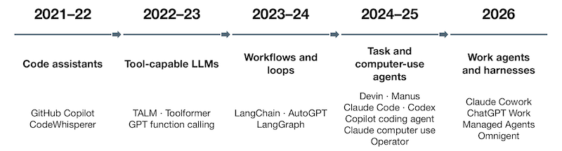

---

### 1.2.1 Code Suggestions and Tool-Calling LLMs (2021~2023)

> [TALM: Tool Augmented Language Models 논문(2022)](https://arxiv.org/abs/2205.12255)

> [Toolformer: Language Models Can Teach Themselves to Use Tools 논문(2023)](https://arxiv.org/abs/2302.04761)

Code assistant 시기, 모델이 코드를 제안할 뿐 실제로 코드를 삽입할지 결정하고 실행하는 주체는 개발자였다. 이후 Tool-calling LLM 시기에는, 모델이 **tool schema**(도구 명세)를 전달받아, 무슨 tool을 어떤 인자로 호출할지를 제안하였다. (실행과 권한 검사는 application이 담당)

| 2021-22: Code Assistants | 2022-23: Tool-capable LLMs |
| :---: | :---: | 
| 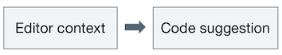 | 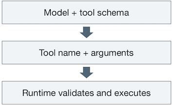 |
| 개발자가 리뷰 및 코드 삽입, 실행까지 담당 | 모델이 사용할 tool과 tool에 전달할 인자를 결정 |

> 참고로 Tool-calling의 제안과 실제 실행의 분리가 본 강의를 관통하는 설계 원칙이다. (모델은 실행 권한을 갖지 않고, 모델 바깥의 runtime이 validate하고 execute한 뒤 결과를 다시 모델에 돌려준다.)

> **Note**: Codex의 발전에 따른 이름의 의미 변화
>
> - Codex (2021): 코드 생성 모델
>
> - Codex (2025): 코드를 생성하는 agent + **그것을 실행하는 runtime**

대표적으로 TALM 논문은 tool에 전달할 입력을 생성(이를 통해 API 호출)하고, 결과를 텍스트 시퀀스에 추가하여 최종 출력을 생성하였다.

| TALM | text-to-text interface |
| :---: | :---: |
| 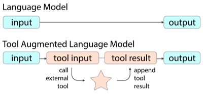 | 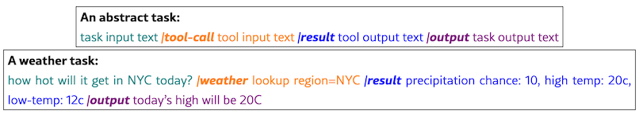 |

Toolformer에서도 모델이 텍스트 중간에 API 호출을 스스로 결정하고, 결과 문장에 반영하는 설계를 제안했다. (아래 그림: 차례로 QA 시스템, 계산기, 기계번역, Wikipedia 검색)

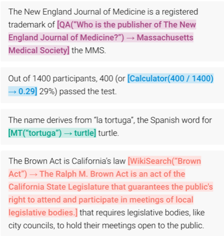

---

### 1.2.2 Workflows and Agent Loops (2023~2024)

> [LangChain Blog: LangChain Expression Language(LCEL)](https://www.langchain.com/blog/langchain-expression-language)

> [LangChain Blog: LangGraph](https://www.langchain.com/blog/langgraph)

이후 2023~24년에는, 개발자가 모델의 tool 호출 순서를 결정하는 **workflow** 방식과, 모델이 스스로 다음 행동을 결정하는 **agent loop** 방식이 등장하였다.

- **workflow**: 개발자가 단계를 결정 (e.g., Retrieve $\rightarrow$ Draft $\rightarrow$ Check)

- **agent loop**: 모델이 다음 행동을 결정 (e.g., Observe $\rightarrow$ Choose action $\rightarrow$ Execute tool 단계를 루프)

| Method | Description | Example |
| :---: | :---: | :---: |
| **Workflow** | 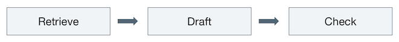 | LangChain LCEL |
| **Agent Loop** | 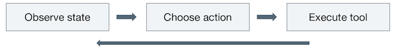 | AutoGPT, LangGraph(2024) |

> **workflow**는 예측 가능하지만 유연하지 않다. 
>
> **agent loop**는 유연(**morph**)하지만 어디서 멈출지나 몇 번 반복할지, 어떤 tool을 호출할지 실행 전에는 알 수 없다.

LangGraph의 경우, agent의 실행 흐름을 state machine으로 관리한다. (edge 설정을 고정하면 workflow로도 동작 가능)

- **State**: 그래프 전체가 공유하는 자료 구조 (각 노드가 갱신)

  ```python
  class State(TypedDict):
      input: str
      all_actions: Annotated[List[str], operator.add]

  graph = StateGraph(State)
  ```

- **Node**: (하나의 단계에 해당) LLM 호출, tool 실행 등

  ```python
  graph.add_node("model", model)
  graph.add_node("tools", tool_executor)
  ```

- **Edge**: 노드 사이를 연결 (이전 노드로 돌아가는 loop 가능)

  ```python
  # tools 호출 후 항상 model 호출이 필요
  graph.add_edge("tools", "model")
  ```

> **Note**: Agent loop가 runtime에 요구하는 책임
>
> agent loop에서 루프의 종료 조건과 자원 사용량은 모델의 출력에 의존한다. 따라서, runtime에서는 필연적으로 실행 횟수나 시간, 비용이 **bound**(제한)되어야 한다.

---

### 1.2.3 Task Agents: A Persistent Workspace (2024~2025)

> [OpenAI: Introducing Codex](https://openai.com/index/introducing-codex/)

2024~25년의 **task agent**는 단순한 일회성 문답에 그치지 않고, 일관된 맥락 속에서 하나의 목표 작업을 완수하는 형태로 진화했다. 

이를 위해 모델 호출과 도구 호출이 반복되는 동안 **workspace**(파일, shell, 테스트 환경)를 유지한다. (**harness**가 관리, 1.2.4절) 

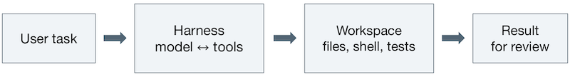

이때 runtime은 세 가지 책임을 지녀야 한다.

| Responsibility | Description |
| --- | --- |
| **retain state** | 호출이 반복되는 동안 파일과 프로세스 상태의 유지가 필요하다. |
| **bound execution** | 루프의 종료 시기나 비용을 미리 알 수 없으므로, 실행 횟수나 시간, 비용에 대한 제한이 필요하다. |
| **mediate access** | 파일에 대한 읽기/쓰기 권한이나, 외부 API 호출을 제한하는 등의 작업이 필요하다. |

> runtime의 이러한 세 가지 책임을 관리하는 SW를 **harness**라고 한다. (1.2.4절)

---

### 1.2.4 Harnesses and Meta-Harnesses (2026)

> [Anthropic: Scaling Managed Agents](https://www.anthropic.com/research/managed-agents)

> [databricks blog: Introducing Omnigent](https://www.databricks.com/blog/introducing-omnigent-meta-harness-combine-control-and-share-your-agents)

현재 task agent는 (1) 토큰을 출력하는 model과, (2) 해당 모델을 반복적으로 호출하며 tool 실행, state 관리, 권한 검사를 수행하는 **harness**로 구성된다.

다음은 harness의 세 가지 역할을 나타낸다. (e.g., Claude Code, Codex CLI 등)

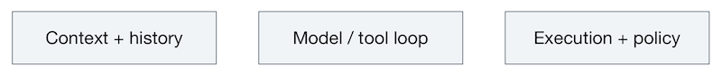

| Role | Description |
| --- | --- |
| **context+history** | 대화 기록, tool 출력, state를 관리하며, 다음 model 호출에 전달할 정보를 결정한다. |
| **model/tool loop** | model과 tool의 agent loop를 실행한다. |
| **execution+policy** | 어떤 action을 허용하며 얼마나 반복할지, 어느 환경(sandbox)를 쓸지 강제한다. |

> **Note** (lifetime): 수명이 서로 다르므로, 다음을 하나의 프로세스에 묶어 두면 안 된다.
>
> - **Session**: 오래 살아남아야 한다(durable).
>
> - **Harness**: 요청마다 생겼다 사라질 수 있다.
>
> - **Sandbox**: 보안을 위해 task 단위로 격리된다.

더 나아가 **Meta-harness**는 서로 다른 harness를 하나의 인터페이스로 제어한다. (e.g., Omnigent: Claude Code, Codex, Cursor 등 여러 에이전트를 하나의 세션에서 활용)

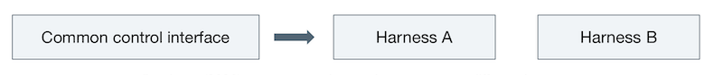

---

## 1.3 Anatomy of an LLM Agent

> [Lilian Weng: LLM Powered Autonomous Agents](https://lilianweng.github.io/posts/2023-06-23-agent/)

다음은 Lilian Weng(from OpenAI)의 2023년 블로그 문서에서는, agent 시스템을 크게 4가지 요소로 구분한다.

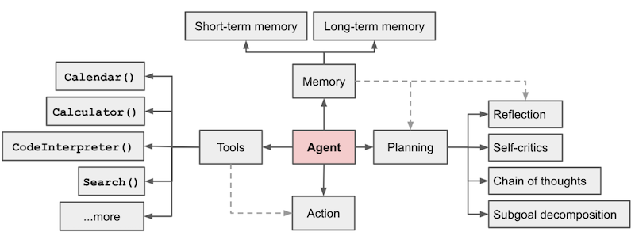

> Agent를 중심으로 planning, memory, tools, action의 네 요소가 연결된다

**(1)** **Planning**

큰 작업을 작은 subgoal로 분해하고, 자기 성찰과 비판(self-reflection, refinement)를 수행한다.

**(2)** **Memory**

- **short-term**: in-context

- **long-term**: 장기간에 걸쳐 정보를 유지하고 회상하는 메모리 (종종 외부 벡터 저장소 활용)

**(3)** **Tool use**

학습한 모델 가중치만으로는 알 수 없는 정보를 외부 API 호출을 통해 보충한다.

**(4)** **Action**

---
