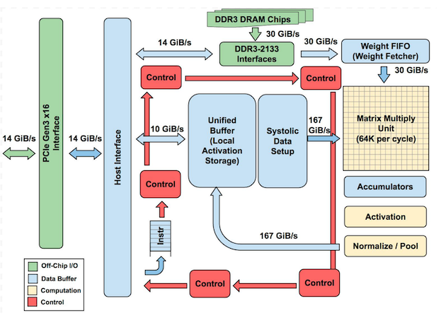
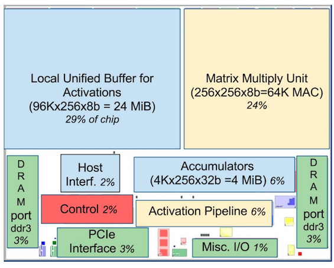
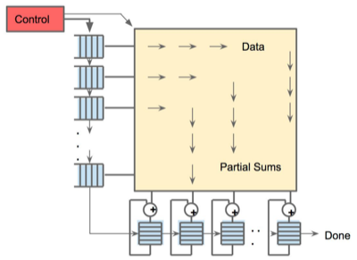
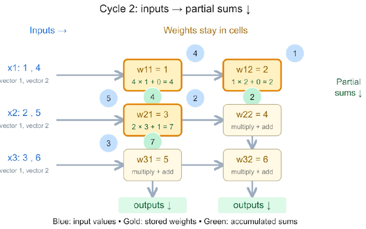
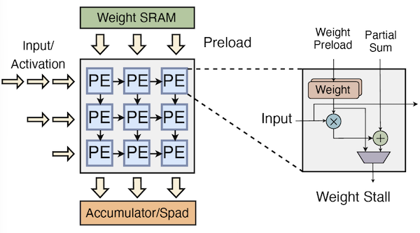
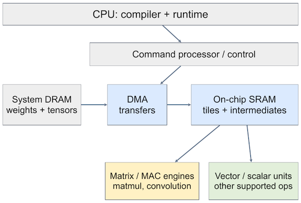
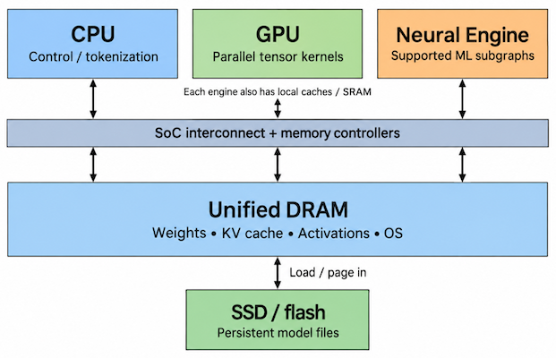
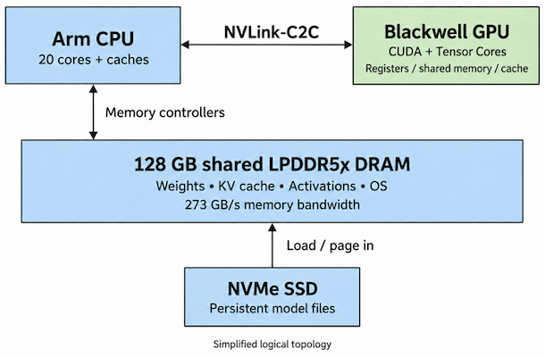
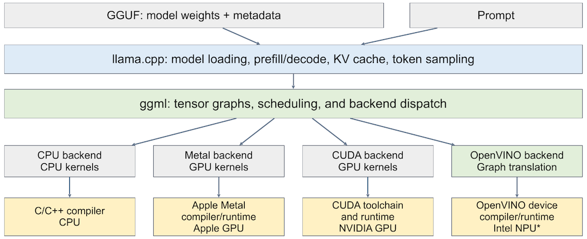
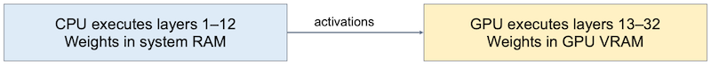

# 5. Edge AI I: Local Inference, Resource Constraints, and NPUs

---

## 5.1 TPU: Matrix Computation as Dataflow

> [In-Datacenter Performance Analysis of a Tensor Processing Unit 논문(2017)](https://arxiv.org/abs/1704.04760)

Google의 **TPU**(Tensor Processing Unit)는 행렬 곱 전용 하드웨어 가속기(**accelerator**)다.

| TPU Block | Floor |
| :---: | :---: |
|  |  |

TPU는 행렬 계산을 **dataflow**로 본다. 다음은 256B 입력을 한번에 읽어 처리하는 행렬 곱 예시를 보여준다.

> **weight**: 미리 256x256 cell에 load되어 머무른다. (참고: 입력, 부분합만 이동)

- **staging buffer**(왼쪽 파란색): 256B 입력이 행마다 한 cycle 늦게(skew) $\rightarrow$ 방향으로 흐른다.

- **partial sum**(부분 합): 위에서 아래로 흐른다. 각 열마다 adder가 바닥의 **accumulator RAM**(총 256개) entry에 부분 합을 저장한다.

> **Notes**: 메모리 접근 이점
>
> - weight: 한 번 load한 후 여러 입력에서 reuse
>
> - partial sum: cell 사이를 직접 이동하므로 메모리 접근 불필요 (출력 저장 시에는 비용 발생)
>
> 그러나, scalar와 vector 연산은 별도의 실행 자원이 필요하며, compiler의 mapping이 utilization을 결정하므로 주의해야 한다.

---

### 5.1.1 Example

한 입력이 array를 다 통과하는 데는 약 256 cycle이 소요되지만, 파이프라인이 채워지면 cycle마다 256개 accumulator가 갱신된다. cycle 단위로 systolic array 동작을 살펴보면 다음과 같다. 

- 두 입력 벡터: $(1,2,3), (4,5,6)$

- **Cycle 0**: 가중치 3x2 행렬 load( $w_{11}=1, w_{12}=2, w_{21}=3, w_{22}=4, w_{31}=5, w_{32}=6$ )

- **Cycle 1**

  - cell `(1,1)`: 벡터 1의 $x_1 = 1$ 가 들어와, $1 \times 1 + 0 = 1$

- **Cycle 2**(그림의 3 cell)

  - cell `(1,1)`: 벡터 2의 $x_1 = 4$ 가 들어와, $4 \times 1 + 0 = 4$

  - cell `(1,2)`: 앞서 `(1,1)`이 오른쪽으로 넘어와 $1 \times 2 + 0 = 2$

  - cell `(2, 1)`: 벡터 1의 $x_2 = 2$ 가 들어오며, 위의 부분합 1을 받아 $2 \times 3 + 1 = 7$

- **Cycle 3**

  - cell `(3,1)`: $3 \times 5 + 7 = 22$ 계산 후, 열 1의 부분 합으로 출력

---

## 5.2 NPU: Neural Processing Unit

> [Intel NPU Acceleration Library: Quick overview of Intel’s Neural Processing Unit](https://intel.github.io/intel-npu-acceleration-library/npu.html)

> [AMD: XDNA Architecture](https://www.amd.com/en/technologies/xdna.html)

**NPU**(Neural Processing Unit)는 신경망 행렬/벡터 연산 가속기를 통틀어 이르는 용어이다.

> TPU와 유사하게, weight SRAM에서 PE array로 가중치를 preload한다. 이후 왼쪽에서 입력/activation이 행마다 들어와 오른쪽으로 흐른다. (곱셈 결과는 아래로 흘러 partial sum으로 누적되며 Accumulator/Scratchpad에 저장)

다음은 NPU 동작을 세 단계로 요약한 것이다.

**(1)** **Compile and load**: compiler에서 그래프를 텐서 tile로 나누고, DMA가 DRAM에서 on-chip SRAM으로 load한다.

**(2)** **Reuse and compute**: 여러 연산 동안 가중치와 partial result를 local에 유지한다.

**(3)** **Pipeline and forward**: double buffering으로 DMA와 overlap하고, 결과를 forward한다.

> **Double buffering**: SRAM 안에 tile을 담을 buffer를 두 개 둔다. MAC engine이 buffer A의 tile을 계산하는 동안, DMA는 다음 tile을 buffer B에 미리 load한다.

> **Forwarding**: 행렬 곱의 출력을 DRAM으로 내보내지 않고 vector/scalar unit으로 바로 넘겨 activation이나 normalization을 이어서 연산한다. (이득: DRAM 접근 최소화)

---

### 5.2.1 GPU vs. NPU: What Should We Measure?

> **Note**: **GPU vs. edge NPU vs. cloud TPU**
>
> | | GPU (NVIDIA) | Edge NPU (typical) | Cloud TPU (Google) |
> | --- | --- | --- | --- |
> | Compute | SIMT core(SM) + tensor core | tensor/MAC engine + vector/scalar unit | systolic MXU + vector/scalar unit |
> | Execution | thread block과 warp에서 kernel 실행 | compiler가 연산자 및 전송을 schedule | compiler가 tensor program을 TPU core에 mapping |
> | Memory | register, shared memory, cache, DRAM | local SRAM + system DRAM와의 DMA | on-chip buffer + HBM, chip 간 링크 |
> | Common role | 그래픽, 범용 계산, 학습과 추론 | PC나 모바일에서 전력 효율적 추론 | 대규모 학습과 추론 |
>
> TPU는 Google의 NPU 계열이다. 'NPU'라는 말은 특정 아키텍처나 배포 규모를 지정하지 않는다. Intel Neural Compute Engine과 AMD XDNA는 설계가 서로 다르다.

참고로 GPU vs. NPU를 공정하게 비교하려면, 각 HW에서의 TOPS가 아닌 다음 지표를 비교해야 한다.

- **Prefill**: workload가 행렬 연산 유닛을 계속 busy하게 유지하는가

- **Decode**: weight 및 KV cache 접근에서 무엇이 제한적인가

- **Memory**: 장치 메모리에 weight, KV cache가 들어가는가 & CPU/GPU/NPU 간의 bandwidth 공유가 효율적인가

- **Software**: 연산자 지원 범위, 컴파일, fallback 비용

- **Energy**: (지속 가능한 의미에서의) joule당 처리 토큰 수

---

## 5.3 Unified Memory Devices

> [Apple WWDC 2020: Explore the new system architecture of Apple silicon Macs](https://developer.apple.com/videos/play/wwdc2020/10686/)

> [NVIDIA DGX Spark Hardware](https://docs.nvidia.com/dgx/dgx-spark/hardware.html)

Edge 장치의 또 다른 특징은 **unified memory**다. unified memory 장치는 <U>CPU, GPU, NPU에서 하나의 DRAM pool을 공유</U>한다.

| Apple Mac mini (M4 Pro) | NVIDIA DGX Spark (GB10) |
| :---: | :---: |
|  |  |

그러나 용량과 대역폭도 공유되므로, 한쪽이 대역폭을 쓰면 다른 쪽이 느려지며 동기화는 여전히 필요하다.

> **Note**: NVIDIA DGX Spark(GB10)
>
> Arm CPU와 Blackwell GPU가 NVLink-C2C로 연결되어 128GB의 LPDDR5x를 공유한다. (별도 NPU는 없다.)
>
> 그러나, 큰 메모리 용량에도 **Decode** 단계(memory-bound)에서 bandwidth(273GB/s)가 제한적인 한계를 갖는다.

---

## 5.4 Local Inference Runtimes

다음은 다양한 하드웨어 backend를 지원하는 세 가지 대표적인 runtime을 살펴보자.

---

### 5.4.1 llama.cpp

> [Github: llama.cpp](https://github.com/ggml-org/llama.cpp), [ggml](https://github.com/ggml-org/ggml)

device code 및 컴파일을 외부 toolchain에 맡기는 구조의 대표적인 추론 엔진이다.

- 입력: **GGUF**(모델 가중치와 metadata를 담는 파일 형식) + Prompt

- **llama.cpp**: 모델 loading, prefill/decode, KV cache, token sampling 지원

- **ggml**: tensor graph 스케줄링 및 백엔드 dispatch

> **Note**: NPU 백엔드 지원은 아직(2026 기준) 제한적이며, OpenVINO(intel) 지원은 진행 중이다.

참고로 llama.cpp에서는 이기종 장치에 모델을 분할하여 offload하는 기능을 제공한다. 다음(**Partial GPU offload**)은 32개 layer 모델을 CPU와 GPU로 분할하여 추론하는 예시다.

- 1~12 layer(CPU): system RAM 가중치로 실행

- 13~32 layer(GPU): VRAM의 가중치로 실행

---

### 5.4.2 Apple MLX

> [Github: MLX](https://github.com/ml-explore/mlx), [MLX-LM](https://github.com/ml-explore/mlx-lm)

(생략)

---

### 5.4.3 OpenVINO

> [Github: OpenVINO Architecture](https://github.com/openvinotoolkit/openvino/blob/master/src/docs/architecture.md)

> [OpenVINO Documentation: NPU Device](https://docs.openvino.ai/2026/openvino-workflow/running-inference/inference-devices-and-modes/npu-device.html)

(생략)

---