# 5. Edge AI I: Local Inference, Resource Constraints, and NPUs

30B 파라미터 모델은 FP16 가중치만으로 약 60GB, 4 bit 기준으로 15GB 메모리가 필요하다. 여기서 KV cache와 runtime buffer 메모리까지 고려하면, 개인 사용자(consumer-grade)의 GPU VRAM 수준(11~24GB)이나 모바일 장치 DRAM으로는 턱없이 부족하다.

즉, 데이터를 필요한 만큼만 옮기면서, 동시에 이기종 연산 장치를 효율적으로 활용하는 방법이 필요하다.

> consumer-grade: GPU VRAM 제약조건으로 CPU 오프로딩 활용. 주로 작은 배치 크기로 추론

---

## 5.5 Prior Approaches and Locality Mismatch

> [FlexGen: High-Throughput Generative Inference of Large Language Models with a Single GPU 논문(2023)](https://arxiv.org/abs/2303.06865)

2023년까지 offloading은 주로 두 갈래 방식을 따랐다.

- **GPU-Centric offloading**: 계산은 GPU, 메모리는 CPU DRAM과 GPU VRAM 함께 사용 (병목: PCIe 전송)

- **GPU-CPU hybrid offloading**: 레이어 일부는 CPU가, 다른 일부는 GPU 계산

| | GPU-Centric Offloading (FlexGen,  ICML 2023) | GPU-CPU Hybrid Offloading (llama.cpp) |
| --- | :---: | :---: |
| | 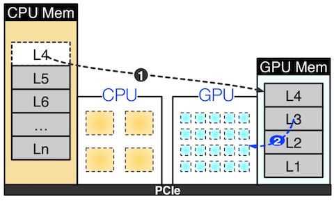 | 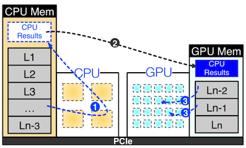 |
| **Computation** | GPU | CPU + GPU |
| **Memory** | CPU DRAM + GPU VRAM | CPU DRAM + GPU VRAM |

문제는 **locality mismatch**다. 예를 들어, 레이어 단위 분할은 CPU에서 (연산이 많이 필요한) 무거운 레이어 묶음을 처리해야 한다.

- **GPU**(연산 능력 우수하지만, **메모리 작음**): 자주 접근하고(**locality**) 작은 working set이 적합

- **CPU**(연산 능력 낮지만, **메모리 큼**): 드물게 접근하고 큰 working set이 적합

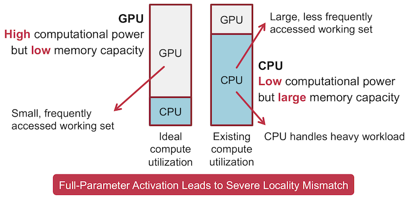

---

## 5.6 PowerInfer: Exploit Activation Locality

> [PowerInfer: Fast Large Language Model Serving with a Consumer-grade GPU 논문(2023)](https://arxiv.org/abs/2312.12456)

> [PowerInfer SOSP 2024 Slides](https://ipads.se.sjtu.edu.cn/_media/talk/sosp2024_powerinfer_slides.pdf)

PowerInfer는 개인용 CPU+GPU 장치에서, **sparse activation** 기반의 메모리 효율적인 추론을 다룬 연구이다. (llama.cpp 기반 확장 구현)

연구의 핵심 통찰은 토큰 하나에 대해 일부의 FFN neuron이 주로 활성화(activate)된다는 발견이다.

> **Note**: **power-law activation**
>
> - 왼쪽: 소수의 26% neuron이 전체 80% 계산에 기여(**hot neuron**)
>
> - 오른쪽: 해당 뉴런들은 서로 다른 task에서도 일관되게 자주 활성화된다.
> 
> - <U>hot neuron은 locality가 높으므로 GPU에 두어야 한다</U>.
>
> | 뉴런 비율에 따른 계산량 | 뉴런 비율에 따른 activation hotness |
> | :---: | :---: |
> | 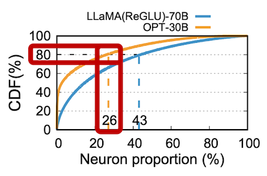 | 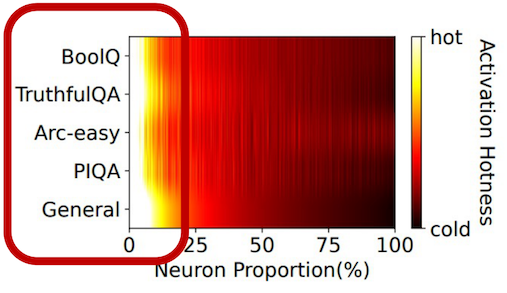 |

뉴런 비율의 상위 20%는 여러 도메인(knowledge-based, truthfulness assessment 등)에서 중복적으로 90% 이상 활성화된다. 반면, 나머지 대다수의 뉴런은 적은 비율로 활성화된다.(**cold neuron**)

따라서, 빈번히 활성화되는 hot neuron은 GPU에 preload, 나머지 cold neuron은 CPU 메모리에 두고 필요할 때마다 direct로 계산한다. (PCIe를 통해 가중치를 GPU로 전송하는 비용이 크기 때문)

> **Note**: **load-then-execute**(GPU에 가중치 전달하여 연산) vs. **direct-execute**(CPU에서 직접 연산)
>
> neuron이 sparse하며 작은 배치 크기(32 미만)로 추론 시, CPU의 벡터 연산을 활용해 직접 계산(direct-execute)하는 것이 더 유리할 수 있다. (아래 예시: OPT-30B, CPU: i9-13900K(AVX2 벡터 확장 사용), GPU: RTX4090)
>
> $$T_{\text{load-then}} \approx T_{\text{weight transfer}} + T_{\text{GPU compute}}$$
>
> $$ T_{\text{direct}} \approx T_{\text{local CPU compute}} + T_{\text{result transfer}}$$
>
> | MLP Block (CPU 뉴런 중 10% 활성화된 상황) | Attention Block (CPU 뉴런 중 60% 활성화된 상황) |
> | :---: | :---: |
> | 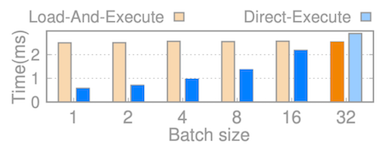 | 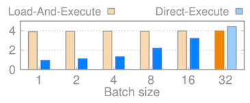 |

> MLP에서 10% 뉴런 상황 근거: 일반적으로 individual inference에서 MLP는 약 10% 수준 활성화되었음

---

### 5.6.1 Adaptive Sparsity Predictors

이러한 sparse activation은 추론 중 동적으로 예측할 수 있다. (1 hidden layer MLP 설계인 **predictor** 학습)

| Sparsely Activated FC1, FC2 | Sparsity Predictor |
| :---: | :---: |
| 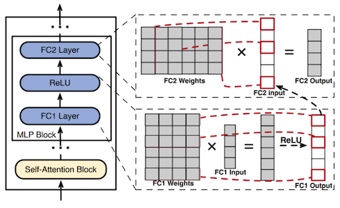 | 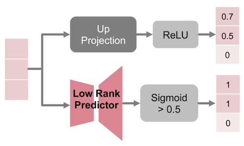 |
| FC1의 ReLU 출력이 0인 행  $\rightarrow$ FC2의 대응하는 열과 계산 불필요(결과=0) | 예측기에서 각 neuron의 활성 여부를 sigmoid로 예측 |

예측기는 GPU 메모리에서 상주하며, 각 레이어에서 입력 벡터를 전달받을 때 먼저 이번 레이어에서 활성화될 확률이 높은 뉴런을 식별한다. (비활성화 뉴런은 연산에서 skip)

다만, 예측기의 크기를 무작정 줄이면 LLM의 정확도 역시 저하되므로, perplexity 차이를 원본 대비 0.1% 이내로 제약하여 최적의 차원 크기를 찾는다. (WikiText-2 데이터셋 활용)

> **Note**: 예측기 차원 크기 탐색 (희소도가 작을수록 큰 예측기 필요)
>
> 다음은 예측기 차원 크기를 결정하는 알고리즘 및 OPT-175B에서 sparsity에 따른 예측기 파라미터 수를 나타내는 도표이다.
>
> **(1)** 각 레이어의 sparsity profile을 수집하고 초기 예측기 크기 결정
>
> **(2)** 반복적으로 0.1% 미만 차이를 만족하는 차원 크기를 탐색
>
> 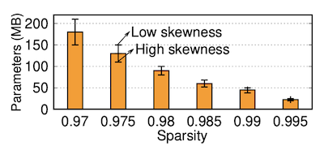

> **Note**: Predictor도 trade-off의 일부
>
> 파라미터 수가 많을수록 정확하지만 추론 시간과 메모리 비용이 든다.
>
> - **False positive**: 불필요한 neuron을 계산하므로 속도 손해
>
> - **False negative**: 정확도 하락

---

### 5.6.2 PowerInfer Design

PowerInfer는 오프라인과 온라인 두 단계로 나누어 이기종 추론을 스케줄링한다.

**(1)** **Profiler & Solver**(Offline): profiler로 각 뉴런의 activation 패턴 수집 $\rightarrow$ solver가 neuron의 메모리 배치(CPU or GPU) 결정

> solver: 뉴런의 활성화 빈도, <U>두 가지 제약조건(VRAM 용량, PCIe 통신 대역폭)</U>을 고려하여 Integer Linear Programming(ILP)을 수행한다.

> GPU의 throughput을 위해 최소한의 할당 비율을 정해 둔다.

**(2)** **Predictor**(Online): 각 레이어의 입력 벡터를 기반으로 활성화될 뉴런 예측

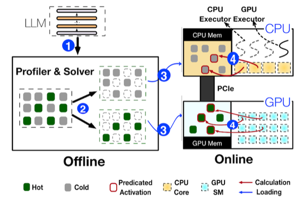

> **Note**: Example
>
> 오프라인에서 뉴런 1~7을, CPU(1, 2, 4, 6) + GPU(3, 5, 7)로 나누어 배치했다고 하자. 
>
> - online predictor에서 2, 3, 5를 활성으로 예측: CPU는 2를, GPU는 3과 5를 계산하고 결과를 merge한다.
>
> - GPU 뉴런의 활성화 빈도가 더 높으므로, merge 연산은 GPU에서 수행한다.
>
> 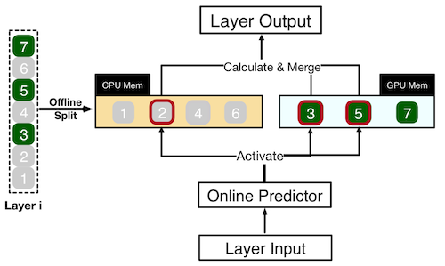

---

### 5.6.3 Neuron-aware Operator

> **Note**: 논문에서 제시한 대표적인 희소 행렬 연산 라이브러리의 문제
>
> 공통적으로 GPU 전용 프레임워크로, CPU-GPU 이기종 추론에 대한 고려는 부족하다.
>
> - **cuSPARSE**: non-zero를 일일이 추적하거나, 런타임에 sparse format(e.g., CSR)으로의 변환 필요
>
> - **SparTA**, **Flash-LLM**: 정적 희소 패턴에 최적화되어 있어, 런타임에 희소 행렬을 dense format으로 변환 필요

PowerInfer는 CPU-GPU 이기종 추론을 고려해, 각 장치별로 효율적인 연산자를 설계했다. (뉴런 단위: row-structured)

- GPU: 행렬-벡터 곱셈 대신 활성화 예측 뉴런의 벡터-벡터 연산으로, 비활성화 뉴런을 skip (thread block이 독립적으로 수행)

- CPU: 뉴런을 배치화해서 멀티코어+벡터 확장 명령어로 활성화 예측 뉴런만 연산

| | |
| :---: | :---: |
| Conventional | 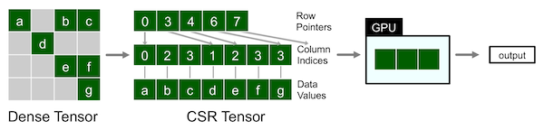
| PowerInfer | 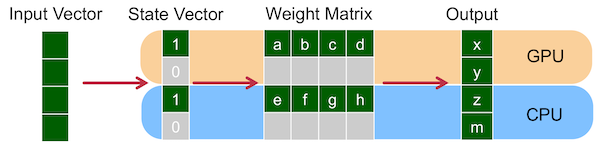

---

### 5.6.4 Results

llama.cpp 대비 여러 모델(OPT(7B~175B), ReLUFalcon-40B, LLaMA2(13B~70B), Bamboo-7B) 비교에서 E2E 성능을 비교하였다.

| Gen. Speed | Load Breakdown | Batch Size |
| :---: | :---: | :---: |
| 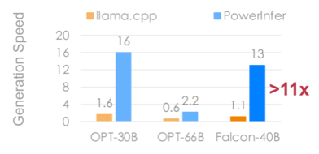 | 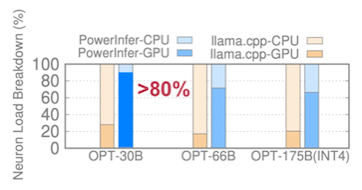 | 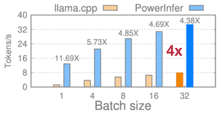 |
| 평균 7.23배, 최대 11.69배 생성 속도 향상 | 계산의 80%를 GPU에서 수행(OPT-30B 기준) (**locality mismatch 완화**) | bs=32 기준 throughput 4배 |

> 양자화(INT4) 모델에서는 평균 2.89배, 최대 8배 속도 향상.  PIQA, Winogrande, Arc-Challenge, MMLU, GSM8K에서 정확도는 원래 모델과 거의 같다.

> **Note**: 결과에서 무엇을 가져갈 것인가
>
> - 모델, precision, context 길이, 출력 길이를 맞추어 비교한다.
>
> - Prefill latency와 decode의 초당 토큰 수를 분리한다.
>
> - 전송, 메모리 대역폭, CPU 작업, GPU utilization을 측정한다.
>
> - 속도만이 아니라 품질, 메모리 사용량, 에너지를 보고한다.

---

## 5.7 PowerInfer-2: When DRAM Is Not Enough

> [PowerInfer-2: Fast Large Language Model Inference on a Smartphone 논문(2024)](https://arxiv.org/abs/2406.06282)

> [Qualcomm AI Engine](https://www.qualcomm.com/processors/ai-engine)

PowerInfer-2는 (스마트폰과 같은) 모바일 환경을 대상으로 한 최적화 설계를 제안하였다. (dense: NPU 연산, sparse: CPU 연산)

- CPU, GPU, NPU에서 각자의 local cache나 SRAM 보유

- SoC interconnect를 통해 공유 LPDDR DRAM 접근 (`LPDDR`: 용량과 대역폭을 OS, app과 공유)

- 모델 가중치는 Flash에 저장하지만 I/O가 매우 느리다. (즉, <U>주된 병목은 flash와 공유 메모리 간의 I/O</U>)

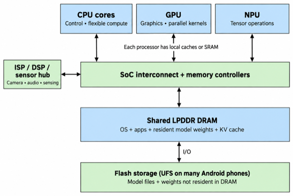

> **Note**: GPU의 역할 제한 (HW: OnePlus 12 기준, Snapdragon 8 Gen 3)
>
> - 실생활에서는 GPU를 주로 렌더링으로 활용하는 제약 존재 (자원 경합)
>
> - 행렬-벡터 연산 기준으로 GPU 대비 CPU와 GPU가 더 빠르게 동작
>
> | 행렬-벡터 연산 실행시간 | 4KB 연산 기준 throughput |
> | :---: | :---: |
> | 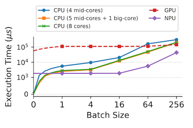 | 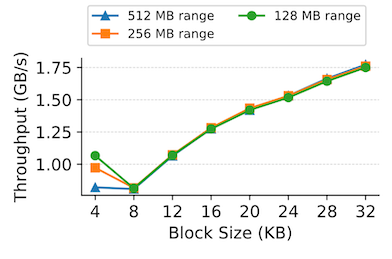 |

> **Note**: 행렬 곱셈 기준 통합 메모리 대역폭 측정 (OnePlus 12)
>
> 이기종 추론에서 제일 메모리 대역폭이 우수했다.
>
> | CPU only | NPU only | CPU-NPU Hybrid |
> | :---: | :---: | :---: |
> | 43.9GB/s | 56GB/s | 59.6GB/s |

---

### 5.7.1 Prefill and Decode Use Different Paths

전체 지연시간의 80% 수준을 차지하는 I/O overhead를 줄이기 위해, prefill과 decode에서 서로 다른 overlap 전략을 사용한다.

- **Prefill**: 많은 토큰을 한번에 처리하므로 대부분의 뉴런이 활성화

- **Decode**: 하나의 토큰을 처리하므로 뉴런이 적게 활성화

| NPU-Centric Prefill | CPU-NPU Hybrid Decoding |
| :---: | :---: |
| 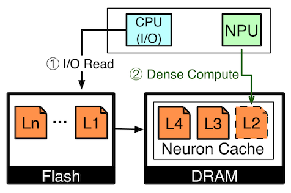 | 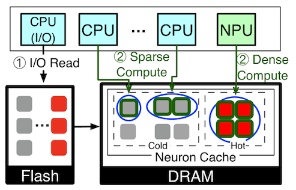 |
| CPU: flash에서 다음 레이어 가중치를 가져와 DRAM 적재 NPU: 현재 레이어의 dense 연산 수행 | CPU: I/O 전용 단일 thread와 cold neuron 연산용 multi-thread 구성 NPU: hot neuron의 dense 연산 수행 |

이때 hot neuron은 행렬보다 더 작은 'cluster' 단위(배치 크기별로 동적 조정)의 묶음으로 파이프라이닝하며, I/O 전용 CPU core가 미리 다음 cluster의 가중치를 적재한다. (cold neuron은 개별 뉴런 단위로 캐시)

> 참고로 I/O를 multi-thread로 요청 시, 큐 경합으로 성능이 최대 40% 하락한다.

---

### 5.7.2 Position-Based Bundling

FFN의 hot neuron을 제외하면, 단일 행렬 내 뉴런 간 동시 활성화 확률은 20% 미만이다. 그러나, Gate, Up, Down 3개 행렬에서 동일한 위치 뉴런끼리는 80% 확률로 동시 활성화되었다.

따라서, PowerInfer-2는 3개 행렬의 가중치를 하나의 단위로 묶어 Flash에서 한번에 가져온다.

| Pipeline | Description |
| :---: | :---: |
| **Per-matrix** | 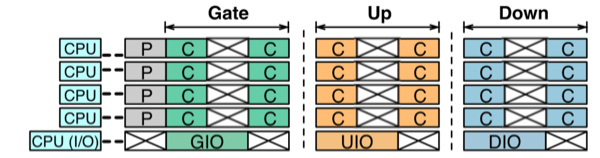 |
| **PowerInfer-2** | 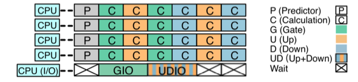 |

> 행렬당 8개 cluster가 있다고 가정한 예시 (4개는 메모리에, 4개는 flash에 존재)

---

### 5.7.3 Results

다음은 Bamboo-7B 모델을 기준으로 한 prefill, decode 처리 속도(tokens/s)를 여러 엔진과 비교한 도표이다. (No offload: 모든 가중치가 DRAM에 있을 때, 50% offload: FFN 가중치 절반이 flash에 있을 때)

- HW: OnePlus 12

- 50% offload 조건에서는 prefill과 decode 모두 기존 프레임워크를 능가하였다.

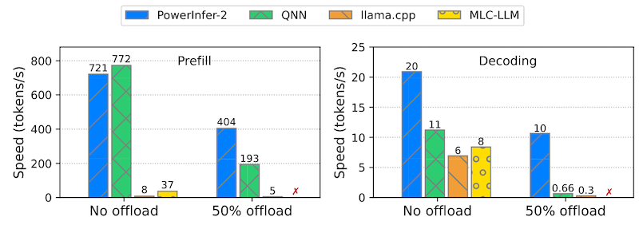

> x 표시: 가중치 offload 미지원

즉, 모바일 환경에서 파라미터 수가 많은 모델을 추론(가중치의 offload가 강제됨)할 때 유용하다.

---
