# 6. Edge AI II: Heterogeneous Execution, Energy, and Adaptive Serving

가속기의 대표적인 성능 지표인 peak TOPS는 end-to-end latency를 예측하지 못한다. 실제 지연시간은 주로 지원 연산자, precision, tensor shape 등으로 결정된다. 

이외에도 그래프 컴파일(NPU 정적 그래프 생성 비용), 동기화, 메모리 접근 비용을 고려해야 하며, shared DRAM의 대역폭이나 다른 application 수행도 병목이다. 

따라서, 먼저 병목의 원인을 **characterize**해야 한다.

---

## 6.1 HeteroInfer: Characterize Before Partitioning

> [HeteroInfer: Characterizing Mobile SoC for Accelerating Heterogeneous LLM Inference 논문(2025)](https://arxiv.org/abs/2501.14794)

HeteroInfer 논문에서는 모바일 SoC(CPU, GPU, NPU 및 통합 메모리 아키텍처)를 고려한 효율적인 이기종 시스템을 제안했다.

논문에서는 processor 단독으로는 shared DRAM의 메모리 대역폭을 다 쓰지 못하며, 이기종 장치를 함께 실행해야 대역폭을 최대한 활용할 수 있음을 관찰했다.

- 최대 가용 대역폭: 61.9GB/s

- 프로세서 단독(CPU, GPU, NPU)으로는 대역폭을 충분히 활용하지 못한다.

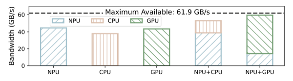

에너지 효율성이 낮은 <U>CPU는 커널 스케줄링 및 프로세서 사이의 동기화를 담당</U>하며, NPU와 GPU는 단계(prefill/decoding)에 따라 주 연산 장치로 활용된다.

| Device | Role | Backend |
| :---: | --- | :---: |
| GPU | decoding 단계의 주 연산 장치(행렬-벡터 연산)로 사용 | OpenCL |
| NPU | prefill 단계의 주 연산 장치(MatMul)로 사용 | QNN-NPU |

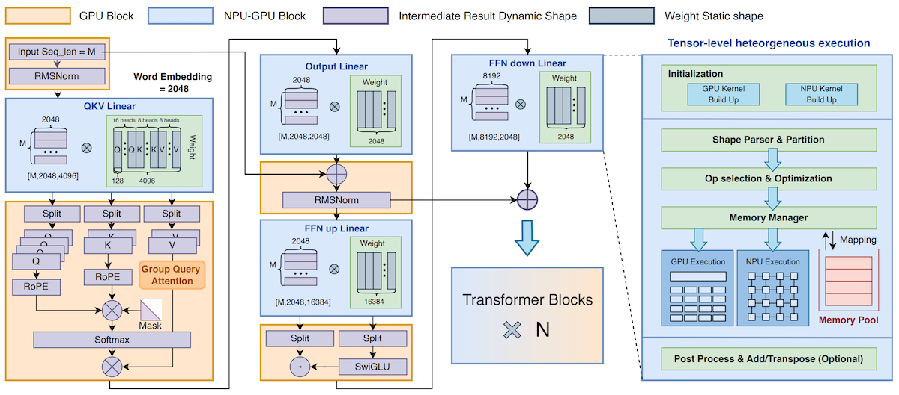

> NPU에서 최적의 연산 효율을 이끌어내기 위해 tensor-level 병렬성을 활용하며, 프로파일링 기반의 지연시간 예측을 통해 분할과 동기화 방식을 선정한다.

---

### 6.1.1 NPU Performance Characteristics

NPU의 설계 특성상, 최대 성능을 이끌어내기 위해 세 가지 요인을 고려해야 한다.

---

#### 6.1.1.1 Stage Performance

NPU 내부의 행렬 연산 유닛은 크기가 고정되어 있다. (e.g., Snapdragon 8 Gen 3: 32x32 크기의 systolic array)

- 입력 텐서의 차원 크기가 정수 배가 아니면, 컴파일러가 내부적으로 **padding**을 추가한다. (**overhead**)

- <U>지연시간은 텐서 크기가 일정 단위(32 단위)마다 계단 모양으로 증가</U>한다.

예를 들어 차원 크기가 33이라면, 컴파일러가 0을 padding하므로 두 개의 tile로 실행된다. 즉, 차원이 64인 만큼 지연시간이 발생한다. 다음은 Snapdragon 8 Gen 3 SoC에서, 차원 크기 $K$ 에 따른 평균 NPU 연산 지연시간이다.

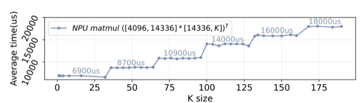

HeteroInfer에서는 padding 추가 대신, 여분의 차원은 GPU에서 병렬로 연산하여 효율을 개선한다.

---

#### 6.1.1.2 Order Sensitivity

> **Note**: NPU의 systolic array는 가중치를 PE에 preload한 뒤, activation이 흘러가며 결과는 SRAM이나 다음 array로 전송되는 구조였다. (Lecture 5)
>
> - 행렬 곱 $A \times B$ 이라면, $B$ 를 가중치로 preload

<U>입력 텐서보다 가중치 텐서 크기가 지나치게 크면</U>, SRAM에 가중치를 자주 load해야 하므로 메모리 비용이 증가한다.

다음은 Snapdragon 8 Gen 3 SoC에서 측정한 텐서의 곱셈 순서, 차원 크기에 따른 FLOAT throughput이다. $[K, 4096] \ast [4096, 14336]$ 의 전치인 $([14336, 4096] \ast [4096, K])^{\top}$ 에서 최대 6배 성능 차이가 나타난다.

- 동일한 연산량 ( $2 \times M \times N \times K$ )의 전치 비교

$$[M, N] \times [N, K] \text{ vs. } [K, N] \times [N, M]$$

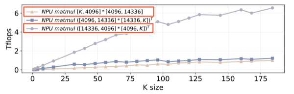

수학적으로나 연산량이 동일해도 preload 대상을 바꿔(transpose) 성능을 개선할 수 있다.

---

#### 6.1.1.3 Shape Sensitivity

> **Note**: 입력 텐서의 열(column) 차원 수 = 가중치 텐서의 행(row) 차원 수

입력 텐서 열의 크기가 늘면 그만큼 가중치 행렬의 크기도 늘어난다. 

- 크기가 늘수록 on-chip SRAM에 적재하기 어렵다.

- NPU의 활용률을 극대화하려면, `입력 텐서의 열 크기 < 행 크기`여야 한다.

다음은 연산량이 같은(수학적으로는 다르다.) 두 행렬 곱의 throughput 차이를 보여준다. $([4096, 14336] \ast [14336, K])^{\top}$ 가 $([14336, 4096] \ast [4096, K])^{\top}$ 보다 가중치 행렬이 3.5배 커서 적재가 어렵다. (reuse 행도 3.5배 적다.)

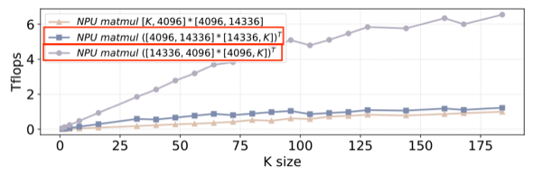

> $([4096, 14336] \ast [14336, K])^{\top}$ : FFN up proj., $([4096, 14336] \ast [14336, K])^{\top}$ : FFN down proj.

---

## 6.2 Layer Placement and Tensor Partitioning

HeteroInfer에서는 GPU와 NPU에서 각자 친화적인 연산을 수행하도록, 연산자를 **layer-level**과 **tensor-level**로 나눠서 할당한다. 이때 tensor-level의 분할은, 오프라인에서 Profiler와 Solver를 활용해 결정한다.

- **Profiler**: GPU, NPU에서 다양한 가중치 텐서 shape와 연산자를 프로파일링 (실행 시간, 메모리 대역폭, 동기화 overhead 등)

- **Solver**: 프로파일링 결과를 바탕으로 최적의 텐서 분할 전략을 선택

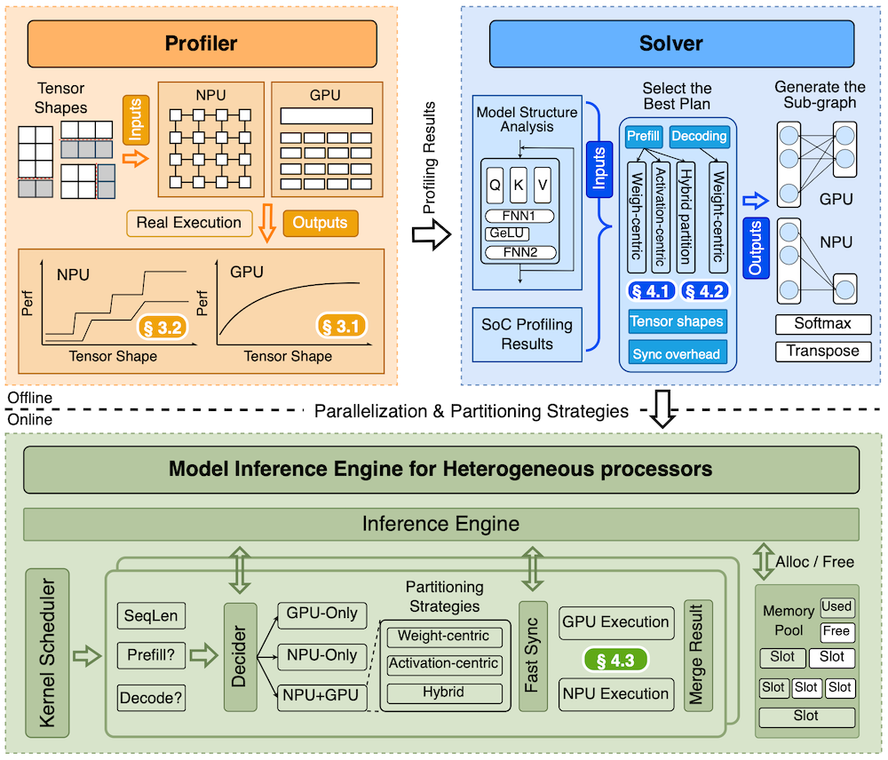

> **Note**: **Latency Estimation** (성능 변화는 GPU: 선형적, NPU: 계단 모양)
>
> solver는 다음 방정식을 통해 가변 길이 sequence에 대해 지연시간을 예측한다.
>
> $$T_{\text{total}} = \min \left( \max (T_{\text{GPU}}^{\text{partition 1}}, T_{\text{NPU}}^{\text{partition 2}}) + T_{\text{sync}} + T_{\text{copy}}, \ \ T_{\text{GPU}}^{\text{all}}, \ \ T_{\text{NPU}}^{\text{all}} + T_{\text{sync}} + T_{\text{copy}} \right)$$
>
> $$ \text{s.t.  Partition1 + Partition2 = All.} $$

---

### 6.2.1 Hybrid Partitioning

텐서 분할은 **weight-centric**과 **activation-centric**의 두 가지 전략을 하이브리드로 활용한다. (activation-centric: 동적 시퀀스 길이를 가진 입력(padding 오버헤드)을 처리하기 위함)

> **Note**: NPU는 정적 그래프 연산만 지원
>
> sequence 길이마다 새롭게 정적 그래프를 생성하기는 어렵다. (e.g., 4096×4096 행렬에서 그래프 생성 시간 = 920ms)

| Partitioning | Description |
| :---: | --- |
| (1) **Weight-Centric** | 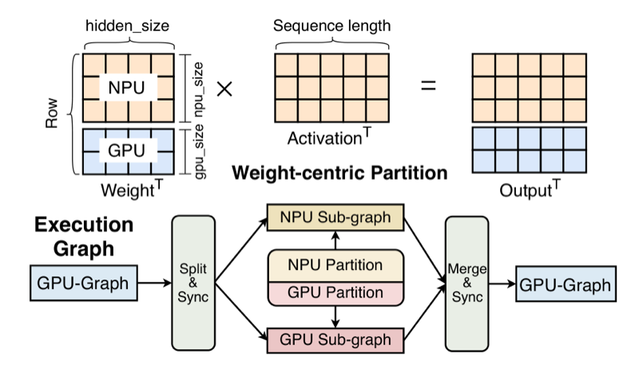 |
| | - 시퀀스 길이가 짧을 때: stage performance 특성상 자원이 낭비될 수 있음 - 전치 행렬의 열이 행보다 큰 경우(e.g., FFN down): shape sensitivity로 성능 저하 - decoding 단계의 메모리 대역폭 활용이 충분하지 않을 때 |
| (2) **Activation-Centric** | 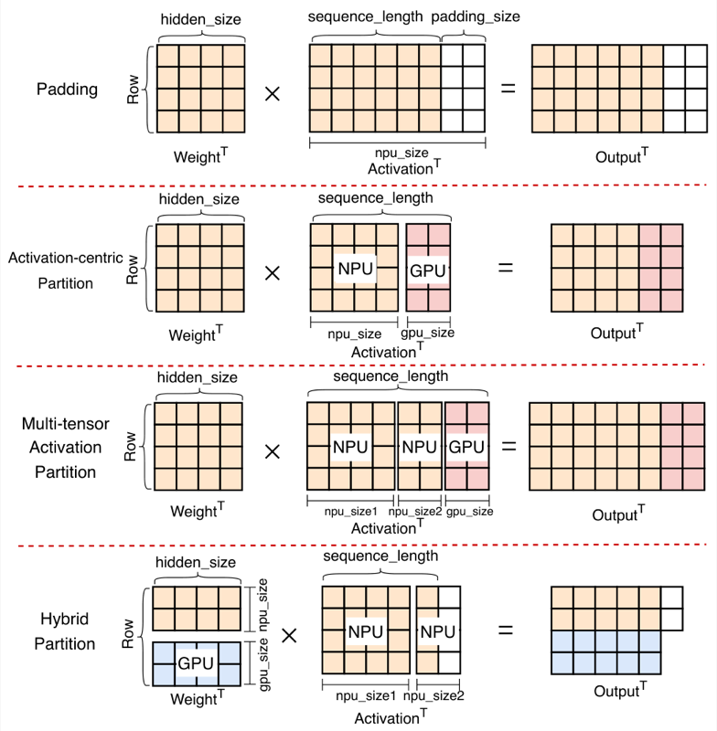 |
| | - 입력을 정해둔 길이(e.g., 256) 만큼 NPU로 실행, 나머지를 GPU offload |

다음은 solver에서 입출력(가중치 텐서, 입력 길이)에 따라 취한 분할 예시이다.

- (Prefill) 가중치 텐서 [4096, 4096], 입력 길이 257~272: activation-centric으로 (256이 아닌) 동적 입력 지원

- (Prefill) 가중치 텐서 [4096, 14336]: 행이 적고 열이 많으므로 2:3 hybrid 분할

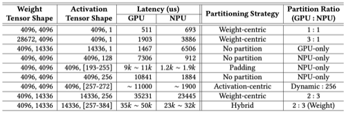

---

### 6.2.2 Fast Synchronization

> **Note**: GPU/NPU runtime별 kernel 완료 알림
>
> - GPU(OpenCL): CPU는 kernel을 queue에 전달하고 대기. 완료는 `clFinish`이나 event를 기다려야 한다. (driver 및 interrupt overhead 발생으로, 약 400μs 지연)
>
> - NPU(QNN): CPU thread에서 QNN execute로 호출하며, NPU가 완료되는 대로 CPU thread가 깨어난다. (수십 μs 수준 지연)
>
> decoding 단계에서 MatMul가 수백 μs으로, 동기화 시간이 연산 시간만큼이나 추가로 필요한 셈이다.

모바일 SoC는 물리 메모리를 공유(UMA)하므로 장치 간 복사가 필요 없다(zero-copy). 그러나 data dependency는 여전히 존재한다. 

> 즉, GPU가 쓴 결과를 NPU가 읽으려면 GPU가 끝났음을 알아야 하고, 두 partition의 결과를 merge하려면 NPU가 끝났음을 알아야 한다.

HeteroInfer는 LLM이 동일한 연산을 반복적으로 수행하므로, GPU의 커널 실행시간을 예측 가능하다는 점을 활용한다.

(1) CPU에서 이전 실행 시간을 바탕으로 GPU kernel 종료 시점을 예측한다. (그전까지는 `usleep`으로 대기)

(2) GPU가 공유 메모리의 flag를 갱신하면, 직전에 깨어난 CPU thread에서 NPU kernel을 즉시 실행한다. (**interrupt 불필요**)

(3) NPU 작업이 끝나면, CPU는 미리 enqueue해둔 GPU merge kernel을 바로 submit한다.

| Phase | Schedule |
| :---: | :---: |
| **Prefill** | 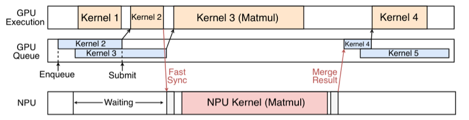 |
| | (주 연산 장치: NPU) GPU의 유휴 시간 발생 CPU가 NPU 연산이 끝나면 바로 GPU merge kernel을 submit |
| **Decoding** | 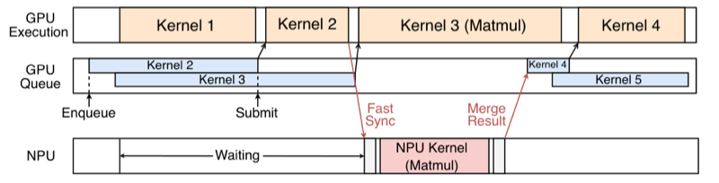 |
| | (주 연산 장치: GPU) NPU의 유휴 시간 발생 GPU 연산이 완료되기 직전에, 후속 GPU 커널을 바로 enqueue하여 stall 방지(예측 기반) |

---

## 6.3 HeteroInfer: Results

다음은 Snapdragon 8 Gen 3에서, 여러 모바일 LLM 추론 엔진과 HeteroInfer(Hetero-Tensor)의 end-to-end latency를 비교한 도표이다.

- 모델: InternLM-1.8B(top), Llama-7B(bottom) 대상 측정 (모델 양자화: W4F16, 배치 크기: 1)

- 작업: multi-turn dialogue(BELLE), simple QA(GSM8K), long text processing

- 비교군: llama.cpp(CPU 전용), MNN-OpenCL(GPU 전용), PowerInfer-2(NPU)

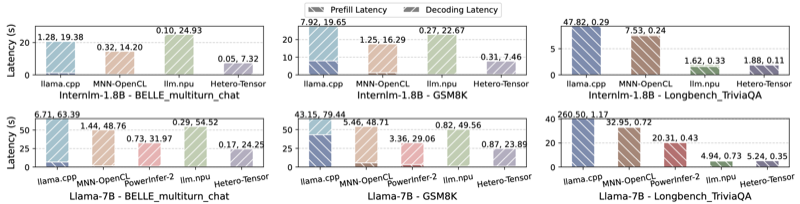

> HeteroInfer의 방법론(tensor partitioning)만이 아니라, 백엔드 kernel(e.g., OpenCL 및  QNN의 백엔드 커널 자체의 성능)에 따른 지연시간 차이도 존재한다. (논문: ablation study에서 제시)

---