# 6. Edge AI II: Heterogeneous Execution, Energy, and Adaptive Serving

이번 정리에서는 에너지 및 주파수 효율성을 고려하는 이기종 추론 및 adaptive serving을 살펴볼 것이다.

> **Note**: **Power**, **Energy**
>
> $$\text{Energy (J)} = \text{average power (W)} \times \text{duration (s)}$$
>
> 8W로 5초 소모 시 40J이며, 5W로 10초 소모 시 50J이다. (따라서, 전력이 낮다고 하여 에너지 소모가 적다고 할 수는 없다.)

> **Note**: $\text{Energy per token} = \text{average system power} \times \text{time per token}$

에너지를 비교할 경우, 동일한 측정 단위와 조건을 맞추도록 유의해야 한다.

- energy **per token** 혹은 energy **per completed task**로 보고

- prefill(compute-bound), decode(memory-bound)를 분리해 보고

- 동일한 답변 quality 조건에서 비교 

> 비교 대상보다 경량 모델 혹은 양자화 모델을 쓰면, 에너지 사용량이 줄어들기 때문

---

## 6.4 CORE: Unified Energy-Aware Scheduling

> [Rethinking DVFS for Mobile LLMs: Unified Energy-Aware Scheduling with CORE 논문(2026)](https://mlsys.org/virtual/2026/oral/3814)

> [CORE MLSys 2026 Slides](https://mlsys.org/media/mlsys-2026/Slides/3814_0uuYG7Z.pdf)

**CORE**는 모바일 이기종 추론에서 장치별 에너지 효율을 끌어내기 위한 최적 주파수를 탐색한 연구이다.

- problem: CPU, GPU, memory 전압을 조절하는 **governors**: 서로 독립적인 까닭에 다른 장치의 utilization은 고려하지 않는다.

  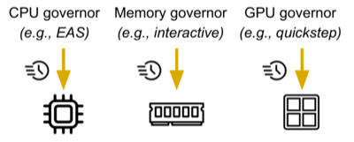

예를 들어 OpenCL을 사용해 GPU 중심의 추론을 하더라도, CPU가 GPU 커널을 dispatch해야 한다.(전력 소모) 이외에도 LLM 추론에서는 메모리에 빈번하게 접근할 필요가 있다.

> **Note**: **DVFS**(Dynamic Voltage and Frequency Scaling)
>
> workload 수요에 따라 하드웨어 **clock frequency**를 동적으로 조정하는 기법이다.
>
> - 높은 주파수: 빠르지만 전력이 많이 들고 뜨겁다.
>
> - 낮은 주파수: 느리지만 전력이 적고 차갑다.

---

### 6.4.1 Why Default Governors Fail

다음은 TinyLlama 추론 중 CPU, GPU 한쪽의 frequency를 고정하고 관찰한 utilization 그래프이다. ( $f_{\text{MEM}}=3172$ 고정 )

- EAS(CPU governor): 일관되게 낮은 주파수를 선택(prefill, decode 모두 40% 미만)

- QuickStep(GPU governor): 활용률이 떨어지는 decode(memory-bound) 단계에서 주파수 하락

| GPU 주파수 고정 ( $f_{\text{GPU}}=701$ MHz ) | CPU 주파수 고정 ( $f_{\text{CPU}}=2188$ MHz ) |
| :---: | :---: |
| 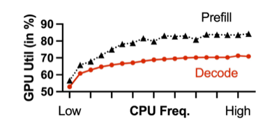 | 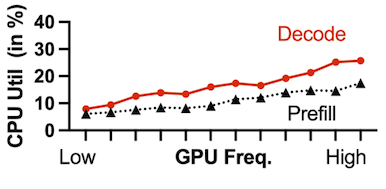 |
| <U>CPU의 OpenCL 런타임 처리가 느려져</U>, GPU에 작업을 전달하는 속도가 느려진다. | <U>GPU의 지연시간 증가</U>로 CPU의 대기 시간이 늘어난다. |

문제는 한쪽의 utilization이 낮아지면서, (일이 없다고 판단한 governor에 의해) 다른 장치의 주파수도 연쇄적으로 떨어지는 악순환이 발생한다.

- GPU 주파수 고정을 해제하면, CPU와 GPU 주파수가 함께 연쇄적으로 떨어진다.

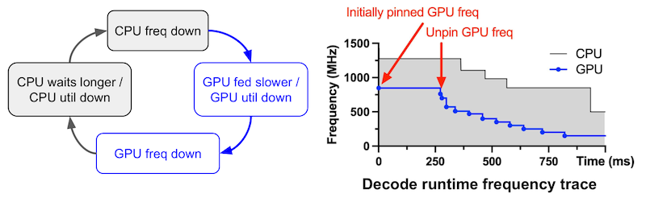

---

### 6.4.2 Energy vs. Frequency Is U-Shaped

다음은 CPU, memory 주파수를 고정( $f_{\text{CPU}}=1826$ , $f_{\text{MEM}}=3172$ MHz )하고, 세 가지 모델의 decode 단계에서 GPU 주파수를 변경하며 측정한 성능이다. (TPOT: Time Per Output Token)

- 최적점(`●`)보다 주파수를 높여도, (위) TPOT는 거의 줄지 않고 (아래) 에너지 사용량만 늘어난다.

- 기본 governor(`X`): 최적점 대비 낮은 주파수를 선택한다.

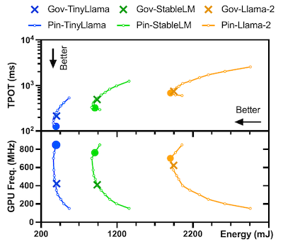

> 세 가지 모델 중 연산량이 많은 Llama-2: GPU utilization이 높아, 기본 governor도 상대적으로 최적 주파수와 가깝게 선택한다.

적절한 최적 주파수를 설정하면, 기본 governor 대비 34.6% \~ 41.0%까지 지연시간을 단축할 수 있다.

---

### 6.4.3 CORE: A Unified DVFS Governor for LLMs

CORE는 지연시간(prefill TTFT, decode TPOT), 에너지 제약 조건에서 최적의 주파수 설정을 탐색하였다.

- Goal 1(`G1`): 에너지 제약 내 최소 지연시간

- Goal 2(`G2`): 지연시간 제약 내 최소 에너지

이를 위해 오프라인에서 2단계 주파수 탐색 과정을 거친다. (탐색 구간: 입력 프롬프트 길이 5개(prefill)+decode 길이 1개 설정)

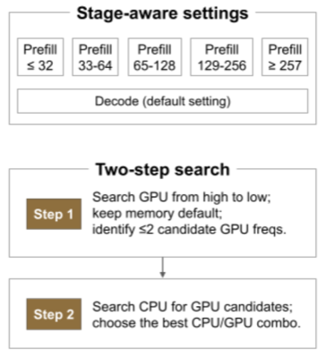

> **Note**: 2단계 주파수 탐색 과정
>
> **(1)** 두 목표를 만족하는 GPU 주파수 탐색 (최고 GPU 주파수부터 탐색)
>
> | Goal 1 | Goal 2 |
> | :---: | :---: |
> | 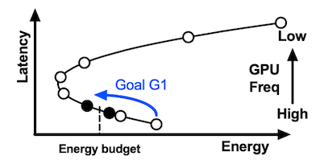 | 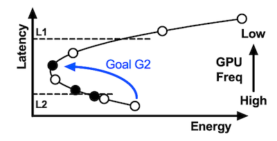 |
> | 에너지 예산 내 최소 지연시간 후보 | 목표 지연시간 내 최소 에너지 후보(최대 2개) |
>
> **(2)** GPU 후보(최대 2개)를 고정 후, 최적 성능/에너지 소비를 가진 CPU 주파수 선정

---

### 6.4.4 Results

다음은 ShareGPT 데이터셋 200개 요청 trace을, 두 goal에서 성능을 비교한 도표이다. (프레임워크: Llama.cpp, OpenCL)

- `G1`: TTFT 8.5~17.7%, TPOT 27.8~39.6%, E2E 23.2~28.8% 감소

- `G2`: 총 에너지 6.3~15.8% 감소 (TPOT도 대체로 함께 개선)

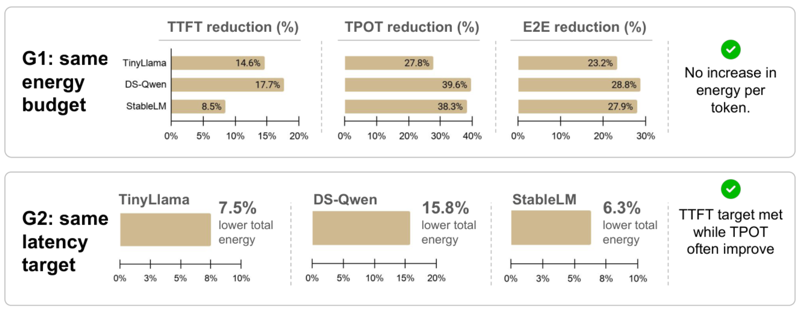

> Pixel 7 및 7 Pro에서 Monsoon 전력 측정기로 배터리를 우회해 측정 (화면은 off)

---

## 6.5 TurboInfer: Save Power During GPU Stalls

> [TurboInfer: Act Before It’s Too Late: Power-Efficient LLM Inference on Mobile Device 논문(2026)](https://doi.org/10.1145/3745756.3809208)

TurboInfer는 모바일 CPU-GPU 추론 시 발생하는 GPU stall 동안, GPU 주파수를 신속하게 조절하여 전력 효율을 극대화하였다.

- 기본 DVFS: GPU stall(추론시간의 상당 부분) 동안에도 고정된 높은 주파수 유지

- TurboInfer: 실시간 GPU 모니터링 및 예측을 바탕으로 주파수 동적 제어

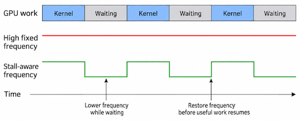

> 주된 stall 원인: (1) OpenCL 특성(CPU가 GPU에 job을 제출하는 방식), (2) Shared DRAM의 대역폭 경쟁

> 백그라운드 작업이 없는 static 환경, 존재하는 dynamic 환경 모두 실험

---

### 6.5.1 Kernel-level, Token-level GPU Stalls

TurboInfer는 GPU stall 비율을 kernel, token 두 레벨에서 정량적으로 측정하였다.

- 연산 능력이 우수한 장치(`D5`): 연산이 빠르게 끝나므로, kernel-level stall이 주된 병목 (최대 74.26%)

- 연산 능력이 부족할수록, 토큰 사이의 decoding 지연이 주된 병목

| | Description |
| :---: | :---: |
| **Kernel-level** | 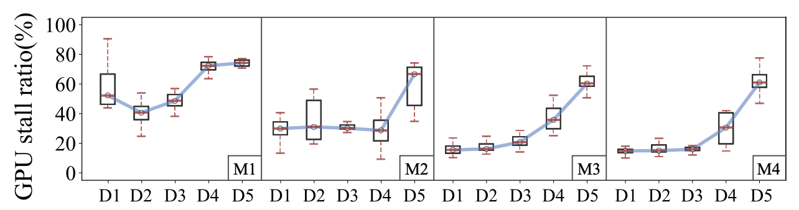 |
| **Token-level** | 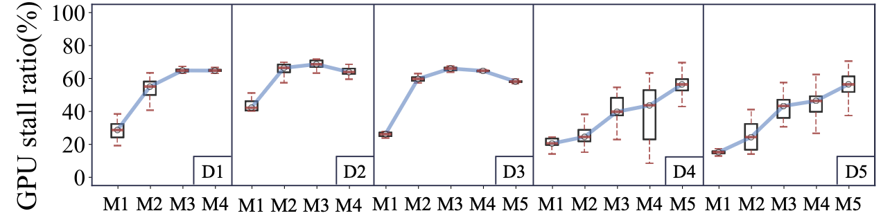 |
| **Device** | `D1`: OnePlus 8, `D2`: Samsung Note10, `D3`: OnePlus 9RT, `D4`: OnePlus Ace Pro, `D5`: Xiaomi 14Pro |
| **Model** | `M1`: Qwen2.5 0.5B, `M2`: Qwen2.5 1.5B, `M3`: Gemma2 2B, `M4`: RedPajama 3B, `M5`: Mistral 7B |

> **Note**: **Token-level GPU stall**
>
> 한 토큰 생성이 끝나면, GPU는 CPU가 입력 및 metadata를 준비하는 동안 대기해야 한다. 
>
> - shared DRAM에서 logits을 읽고 sampling 수행(vocabulary lookup 포함)
>
> - 방금 토큰의 K, V를 KV Cache에 갱신하고, attention mask의 position 갱신
>
> - 다음 토큰 생성을 위한 kernel 제출

---

### 6.5.2 ms-level Switching and Real-time Monitoring 

kernel-level의 지연은 수\~수십 ms 단위인 경우가 많아, 주파수 갱신이 신속하게 이루어져야 한다. 하지만, 기존 인프라(Kernel Space의 Thermal framework)는 약 80ms의 지연을 가지므로, 제때 주파수의 조절이 불가능하다.

따라서, TurboInfer는 User Space에서 커널 드라이브를 직접 호출(`IOCTL`: Input/Output Control 시스템 호출)하여 µs 단위로 제어한다.

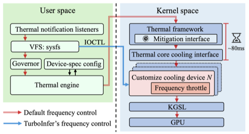

또한, `IOCTL`을 통해 **PMU**(Performance Monitoring Unit) 레지스터를 읽어 GPU stall을 µs 단위로 모니터링하는 것으로 실시간 제어를 수행한다. 

> **Note**: PMU(Performance Monitoring Unit)
>
> GPU가 커널을 실행할 때, 내부 PMU 카운터가 ALU에서 처리하는 명령어 수(`SP_ALU_INSTRUCTIONS`), cycle당 평균 load/store 명령어 수(`Avg_Load_Store_INSTRUCTIONS_Per_Cycle`)를 실시간으로 레지스터에 기록한다.

---

## 6.6 Adaptive Serving

더 나아가 여러 machine이 나눠서 모델을 추론하는 환경도 최적화가 필요한 대상이다.

| | Within one SoC | Across Machines |
| :---: | --- | --- |
| **Decision** | 백엔드(CPU, GPU, NPU) 선택, 텐서 분할 등 | **request** 하나 전체를 routing |
| **Adaptation** | 텐서 모양, 지원 연산자, 동기화 비용 등 | 대기 request, 모델 load 여부(residency), 통신 비용 등 |

> 예를 들어, cloud는 빠르지만 prompt를 보내고(request) 토큰을 받아 오는 통신 비용이 든다. 

다음 두 기기 예시를 보면, A는 계산이 두 배 빠르지만 request 대기 3초로 길다.

- **Machine A**: transfer 0.2초, queue 3.0초, compute 1.0초 (=4.2s)

- **Machine B**: transfer 0.2초, queue 0.2초, compute 2.0초 (=2.4s)

따라서, 단순히 연산 능력만으로 판단해서는 안 되며, 각 기기의 queue 상태 및 모델의 residency를 고려한 routing이 필요하다.

> **Note**: **Foreground Response** (목표 성능)
>
> 사용자의 foreground request(채팅 입력)에서 TTFT, TPOT 성능을 만족할 수 있도록, background 작업이 수행되어야 한다.

이를 위한 **adaptation**은 프로파일링 및 이를 기반으로 한 예측기를 필요로 한다. 다음은 프로파일링 시 주의해야 할 네 가지 대표적인 사례다.

**(1)** **warmup**: 첫 실행은 NPU 그래프 컴파일, 커널 load, 가중치 page-in 등 매우 느린 지연시간을 갖는다. (프로파일링은 **steady state**를 기준으로 해야 한다.)

**(2)** **thermal throttling**: 발열에 의한 주파수 하락과, 동시에 수행되는 application에 의한 부하 조건도 포함해야 한다.

**(3)** **whole-system measurement**: 특정 장치(e.g., GPU)의 전력만이 아닌, 시스템 전체의 에너지를 측정해야 한다.

**(4)** **same quality**: 동일 출력 품질, 모델, 양자화 조건, 입출력 길이 등을 만족해야 공정한 에너지, 지연시간 비교가 가능하다.

---